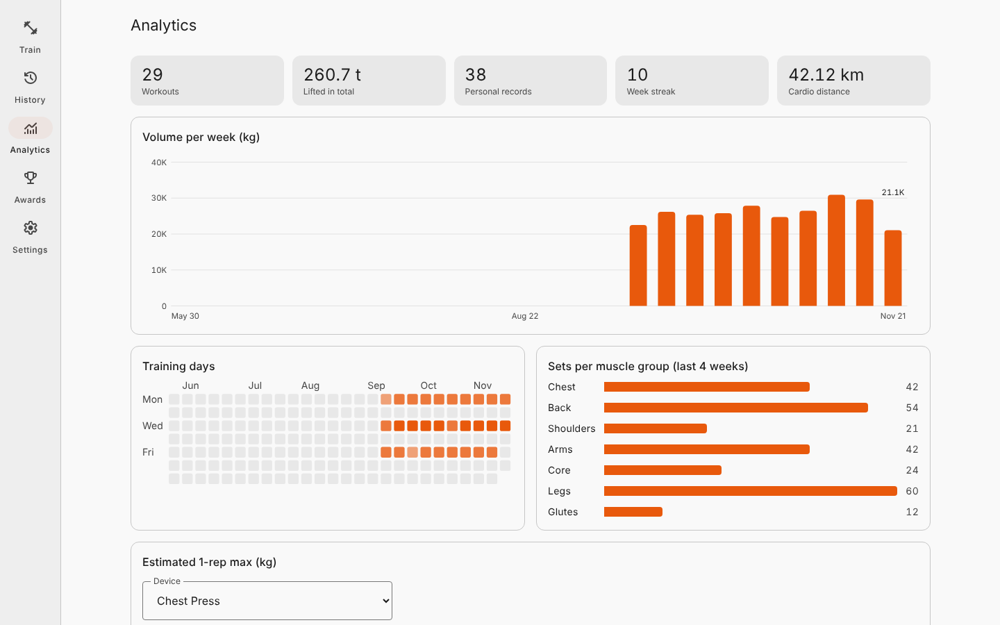
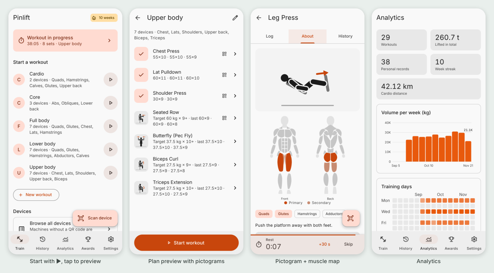
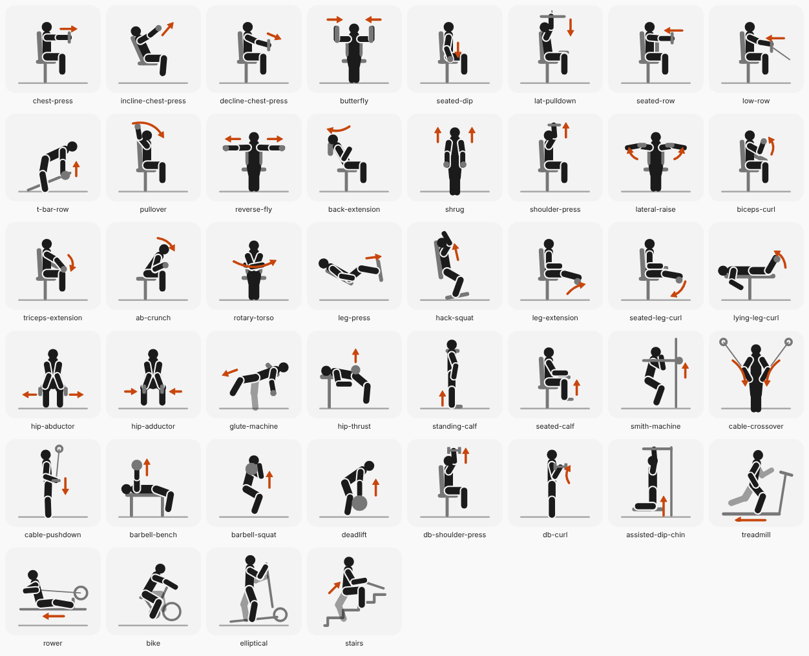

# Pinlift

An offline-first PWA for tracking gym progress. It has no backend, and data stays on your devices.





## Features

- **First-run introduction**: four short steps on a fresh install: scanning machines, *no account and no server, all data stays on this device*, plans/records/badges, and how to install the app (Chrome's install button, or Share → Add to Home Screen on iPhone). It can be reopened from Settings.
- **Scan to log**: scanning a machine's QR code opens it directly, with your last sets and a suggested next weight.
  - The first scan of an unknown code asks which device it is, then remembers the link.
  - Devices without a QR code are listed first, with search and muscle-group filters.
- **Suggested next weight (double progression)**: per device you set a rep range (default 8–12) and a weight step.
  - When every top set reaches the top of the range, it suggests one step up.
  - Below the bottom of the range, it suggests one step down.
  - Otherwise it suggests adding reps.
- **During a workout**:
  - A rest timer after every set: it vibrates when time is up (optional sound in Settings, useful on iPhone, which cannot vibrate from websites); +30 s and Skip; rest time set per device.
  - The screen stays on while a workout runs.
  - Tap a set to edit it; deleting a set can be undone; sets can be marked as warm-up or drop sets.
  - Plan rows show each target; after a set there's a "Next" shortcut and a shortcut back to devices used minutes ago (supersets).
  - A workout left open is offered to be finished at its real end, so forgetting Finish doesn't spoil your history.
  - Finished workouts can be edited.
- **Device catalog**: about 40 prefilled devices (gym80-style selectorized and plate-loaded machines, free weights, cardio).
  - Each has its own pictogram (figure, machine and an arrow for the movement; see below), a muscle map (primary and secondary muscles), a short description, form cues and a link to technique videos.
  - Per device you can store setup notes (e.g. "Seat 5"), adjust the step and rep range, or hide it.
  - Assisted machines (dip/chin assist) count progress as less assistance and add no lifted weight.
  - One QR code can open several exercises (Smith machine, cable tower); when linking a new code mid-workout, the next devices of your plan are offered first.
- **Workouts**: Upper body, Lower body, Core, Push, Pull, Full body and Cardio are included. You can build your own from muscle groups, reorder devices, or train freely.
  - Tapping a plan shows its machines with today's targets; only ▶ (or *Start workout*) starts it.
- **Cardio**: treadmill, rower, bike, cross trainer and stair climber.
  - You log minutes and seconds plus distance (optional for bike and cross trainer; floors on the stair climber). Speed and pace (per km, or per 500 m for rowing) are calculated, and implausible values are flagged.
- **Gamification**:
  - Personal records: heaviest weight (or least assistance), fastest pace, longest distance, most floors. Rep gains show as "+1 rep vs last time".
  - 32 badges: streaks, total tonnage (from "Elephant mover" up to "Blue whale"), 5K/10K, 2K row, and more.
  - A weekly training streak.
  - A workout summary that compares the total you lifted to everyday objects.
- **Analytics**: a dashboard with workouts, total weight, records, streak and cardio distance. It also shows volume per week, training days as a calendar heatmap, sets per muscle group over the last 4 weeks, est. 1RM trend per device, best sets, recent records and recent workouts.
- **Desktop**: from 840 px wide, a side navigation rail replaces the bottom bar and pages use the width (multi-column dashboard). The app opens on Analytics there.
  - Importing is always one click away: *Receive from phone* (scan the phone's codes with the webcam), *Import file*, or drag a file onto the page.
  - A status line shows the latest workout and when data was last imported, and warns when the import is more than 3 days old.
- **Transfer between devices**: Settings → *Send* shows a cycling series of QR codes; the other device scans them with *Receive*.
  - Data is merged record by record, and the newer change wins.
  - You can send only what changed since the last send.
  - JSON export and import and a CSV export also work; a reminder appears when the last backup is two weeks old.
- **Strava**: posts a finished workout as a *Weight Training* activity, or as *Run* / *Rowing* with distance for cardio-only sessions.
- **Updates**: when a new version is deployed, the app shows *"A new version is available → Reload"*.
  - It checks on launch, whenever the app returns to the foreground, every hour, and from Settings → *Check for updates*.
  - Reloading is safe mid-workout because the running session is stored.

## Deploy

The app is a static site, so any HTTPS host works. Camera access, installation and offline mode require **HTTPS**.

### GitHub Pages

`.github/workflows/pages.yml` runs the unit and end-to-end tests on every push to `main`, then deploys to `https://<user>.github.io/<repo>/`.

One-time setup: repository **Settings → Pages → Source: GitHub Actions**. Pages for private repositories needs a paid GitHub plan. The site itself is public, but your training data stays on your devices, so visitors only see an empty app. For Strava, set the callback domain to `<user>.github.io`.

### Docker

```sh
docker compose up -d --build   # serves on 127.0.0.1:8080
```

Put it behind your TLS reverse proxy. If the proxy runs in Docker, remove `ports` and attach the service to the proxy's network. nginx revalidates `index.html`, `sw.js` and the manifest on every request, and caches hashed assets for a year. The unit tests run during the image build.

### Either way

New versions reach installed apps through the update prompt. The service worker downloads new files past the browser cache, so hosts that cache files (GitHub Pages: 10 minutes) can't serve an old page to a new version. The Content Security Policy ships inside `index.html`, so it also applies where a host can't set headers.

On the phone, open the site and **Add to Home Screen**. On iOS this also protects the data: Safari deletes storage of sites that aren't installed after 7 days without a visit.

## Strava (optional, one-time)

Strava's token exchange needs a client secret, so you use your own (free) Strava API app:

1. At <https://www.strava.com/settings/api>, create an app and set *Authorization Callback Domain* to your app's host name.
2. In Pinlift, go to Settings → Strava, paste the Client ID and Client Secret, and tap **Connect**.

The secret and tokens are stored only on that device and are never included in QR or file transfers. On iPhone, the login may finish in Safari instead of the installed app. In that case the page shows a code to paste under *Settings → Strava → Got a code*.

## Architecture

There is no server. Each device holds a full copy of the data in IndexedDB, and devices sync by scanning QR codes or exchanging a file. Every rule that merging relies on therefore runs in the browser.

### Layers

| Layer | Modules | Responsibility |
|---|---|---|
| Views | `screens/*`, `screens/device/*`, `components/*` | Render and call actions. Shared pieces: `ListItem`, `Tile`, `SwitchRow`, `Stepper`, `RestBar`, `Scanner`, `Chart`, `Heatmap`, `HBars`, `MuscleMap`, `Pictogram`, `PlanRow`. |
| State | `store.ts` | One in-memory `AppData` plus device-local `LocalState`. `update()` copies the data, applies the change, saves it and re-renders subscribers. |
| Actions | `actions.ts` | Every data change. Destructive actions return their undo. A forgotten workout is closed at its real end. |
| Selectors | `selectors.ts` | Pure reads: device lookup and options, active session, remaining plan, superset partners, QR links. |
| Domain | `stats.ts`, `progression.ts`, `badges.ts`, `cardio.ts` | Volume, PRs, progress series, the "hardest set" rule, double progression, badges and streaks, sets per muscle group, daily volume, the table of cardio machine types. |
| Sync | `merge.ts`, `sync.ts`, `wire.ts`, `transfer.ts`, `base45.ts` | Merging, validation and versioning, the compact transfer format, QR framing. |
| Adapters | `db.ts`, `router.ts`, `pwa.ts`, `strava-flow.ts`, `backup.ts`, `routes.ts` | Browser APIs and side effects. |

### Data

- **`AppData`** (synced): five collections of records: `sessions`, `workouts`, `customDevices`, `deviceSettings`, `qr`.
  - Every record carries `updatedAt`. Deletions are kept as tombstones (`deleted: true`) so that they sync.
  - The built-in device catalog lives in code; device ids are only ever added, never changed.
- **`LocalState`** (never transferred): Strava credentials and tokens, preferences, backup timestamps.
- **Derived data:** PRs, badges and streaks are computed from the workout history (`useDerived`), never stored, so merging can't make them inconsistent.
- **Persistence:** one IndexedDB key per state object, in a database still named `gym-tracker` (the app's earlier name, kept so existing data survives the rename). It is written immediately after every change. Open tabs announce each save on a `BroadcastChannel`, and the others reload from IndexedDB instead of writing back stale data.

### Sync between devices

- **Merge:** per record, the newer `updatedAt` wins. Ties are broken by comparing content, so both devices end up with the same result.
- **Clock skew:** a write is always stamped later than the record it replaces, so an edit wins even against a device whose clock runs ahead.
- **Validation:** stored data, QR transfers and files all pass through `sanitize()`.
  - Damaged records are skipped and reported, so one bad record can't break the app.
  - Timestamps more than a day in the future are clamped.
  - If a screen still throws, a recovery screen offers a data export.
- **Versions:** `schema` stays 1 as long as changes only add optional fields. Writes keep any fields they don't know, so an older app version doesn't strip data written by a newer one. Data with a newer schema is refused with a "please update" message.
- **Transfer format:**
  - JSON is converted to the wire format (`wire.ts`): times inside a workout become seconds after its start, which is lossless, and new records use short ids.
  - The result is compressed (deflate-raw), encoded as Base45 (RFC 9285, which packs bytes into QR's alphanumeric mode) and split into frames `GT2:<id>:<i>/<n>:<chunk>`.
  - The frames cycle on screen; the receiver collects them in any order.
  - A year of training is about 80 codes at Medium density. Older `GT1` frames are still accepted.

### Pictograms

Every machine has a pictogram drawn from data rather than an image file. `data/pictograms.ts` describes:
- a pose: joint angles of a stick figure, in side or front view;
- simple machine parts: seat, pads, handles, cables, plates;
- an arrow for the movement.

`components/Pictogram.tsx` turns this into SVG in the theme's colours. A new machine therefore takes a few lines, and custom devices fall back to a generic pictogram for their kind.

### Offline and updates

- **Service worker:** a Vite plugin (`build/sw-plugin.ts`) generates it, precaching every build file under a cache named after the content hash. Requests are served cache-first.
- **Updates:**
  - A new version installs in the background, fetching past the browser's HTTP cache, and waits.
  - Tapping *Reload* activates it, and every open tab reloads.
  - The app checks for updates on launch, when it returns to the foreground, every hour, and on demand.
- **Security:** the Content Security Policy is built into `index.html` (`build/csp-plugin.ts`), and the app refuses to run inside a frame. Both also hold on GitHub Pages, which can't send security headers.

### Tests

- **Unit tests:** about 85, using Node's test runner directly on the TypeScript in `src/lib`, actions included. They cover domain rules, sync, validation and the wire format. Shared test data builders live in `src/lib/fixtures.ts`.
- **End-to-end tests:** 45 Playwright tests. They cover:
  - scanning and data transfer, with Chromium's fake camera fed generated QR videos;
  - a redeploy on a server that caches like GitHub Pages;
  - offline mode, two open tabs, damaged imports, the crash screen and violations of the security policy.

  Helpers wait until data is actually stored before they reload a page.
- **CI** (`pages.yml`) runs both suites and deploys exactly the build it tested.
- **Mutation checks:** every test was seen failing, either before its feature existed or after breaking the code it guards.

### Known limits

- **Speed:** every change copies and saves the whole document. That is fast for 2–3 years of data; at 5 years, logging a set takes about 0.3 s on a slow phone. The next step would be copy-on-write in `update()` plus one IndexedDB key per workout.
- **Test coverage:** the e2e tests run in Chromium only (no WebKit). iOS needs Safari 16.4 or later.
- **Single gym:** device settings apply globally, so there's no per-gym seat setting. Interface text is English only.

## Develop

```sh
npm ci
npm run dev          # http://localhost:5173
npm test             # unit tests (Node's built-in runner)
npm run e2e          # Playwright end-to-end tests (builds + previews the app)
E2E_BASE_URL=http://localhost:8080/ npm run e2e   # same tests against a running deployment
E2E_PREBUILT=1 npm run e2e                         # test the existing dist/ (as CI does)
```

The end-to-end tests feed Chromium's fake camera with generated QR-code videos, so device scanning and multi-code transfers are tested through the real camera pipeline.

**Stack**: Preact + TypeScript + Vite, `uqr` (QR generation), and `jsqr` (QR decoding fallback when the native `BarcodeDetector` is unavailable, e.g. iOS and desktop Linux/Windows). The service worker, IndexedDB store, router, charts and Base45 codec are hand-written. The design follows Material Design 3: tokens are generated from seed `#F4511E` with neutral surfaces, and the orange primary is tuned to keep 4.5:1 contrast for button text. There are light and dark themes, a navigation rail on desktop, and Material Symbols icons. The machine pictograms are drawn for this app (`components/Pictogram.tsx`, `data/pictograms.ts`).
